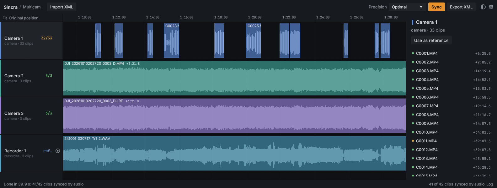
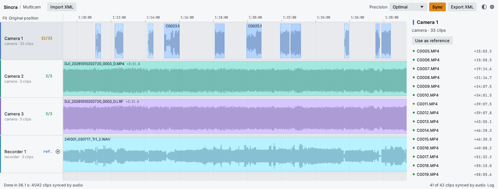

# Sincra

**English** · [Português](README.pt-BR.md)

Automatic multicam sync by audio. Import the "raw" timeline (Final Cut Pro 7 XML exported from
DaVinci Resolve or Premiere) and Sincra gives it back with every camera lined up with the audio
recorder, as `<name> - synced.xml`.

A native Rust binary for **Windows and macOS** (Intel and Apple Silicon), with a graphical interface and
a command line. ffmpeg ships with it.



<details>
<summary>Light theme</summary>



</details>

## Install

**macOS** (Terminal):

```bash
curl -fsSL https://raw.githubusercontent.com/alexclaz/sincra/main/install.sh | sh
```

Installs `Sincra.app` in `~/Applications` and the `sincra` command in `~/.local/bin`. The app is not
signed or notarized by Apple. Because it is downloaded with `curl` and not a browser, macOS does not flag
it as "downloaded from the internet" and Gatekeeper does not block it.

**Windows** (PowerShell):

```powershell
irm https://raw.githubusercontent.com/alexclaz/sincra/main/install.ps1 | iex
```

Installs to `%LOCALAPPDATA%\Programs\Sincra`, adds a Start menu shortcut and puts `sincra` on the PATH.
No administrator rights needed, and SmartScreen does not block it (same reason as on macOS).

To install a specific version, set `SINCRA_VERSION=v0.2.2`. To uninstall:

```bash
curl -fsSL https://raw.githubusercontent.com/alexclaz/sincra/main/install.sh | SINCRA_UNINSTALL=1 sh
```

```powershell
$env:SINCRA_UNINSTALL=1; irm https://raw.githubusercontent.com/alexclaz/sincra/main/install.ps1 | iex
```

## Usage

### Interface

1. **Import XML**, drop the file on the window, or pick a recent one. If the XML has more than one
   sequence, choose it next to the name.
2. Pick the **Precision** in the toolbar (see the modes below). The default is *Optimal*.
3. **Sync**.
4. **Export XML** and import the file in Resolve or Premiere.

The main view is the timeline, one track per device. The track header shows how many clips matched by
audio, and the ring on the right pins that device as the reference. The clip itself shows the result:

- **solid**: matched by audio (the more opaque, the higher the confidence);
- **hatched**: the audio did not match and the clip was placed by its creation time;
- **dashed outline only**: not synced (left where it was in the XML) or file not found.

Each clip shows the offset that was applied (e.g. `+3.2 s`), and *Original position* draws where it was in
the imported XML. Click a clip to see its details in the right-hand panel. Ctrl + scroll zooms, dragging
pans, *Fit* shows everything. The bottom bar shows the last message; *Log* opens the full history.

The gear holds the language (English by default, Portuguese, or the system language), the theme (light or
dark; follows the system by default, and the half-circle button in the toolbar toggles it), the clip
order, chronology, label colors, file suffix, audio cache, path redirection and the folders to search
for media that moved.

### Command line

```bash
sincra "Timeline 1.xml"
```

```bash
sincra "Timeline 1.xml" -m thorough -o output.xml
```

```bash
sincra "Timeline 1.xml" --remap "E:/Projects=/Volumes/HD/Projects"
```

```bash
sincra "Timeline 1.xml" --list
```

`--list` shows the sequences and the detected devices. Messages are in English; use `--lang pt` (or the
`SINCRA_LANG=pt` variable) for Portuguese and `--lang auto` to follow the system. `sincra --help` lists
every option. Without arguments, `sincra` opens the interface.

## Modes

| Precision (`-m` on the command line) | What it does |
|---|---|
| Approximate (`approximate`) | Creation times only, no audio (about 1 s of error, and the clocks must be right). |
| Very fast (`very_fast`) | One coarse pass (1 kHz), no fine refinement. |
| Fast (`fast`) | Coarse pass at 1 kHz + fine refinement at 8 kHz. |
| Advanced (`advanced`) | Multiple passes at 2 kHz, without using the clocks to narrow the search. |
| **Optimal** (`optimal`) | Multiple passes, using creation times to predict where to search. Best for original media. |
| Thorough (`thorough`) | Like Optimal, but does not trust the clocks (proxies, downloaded files). |
| Utmost (`utmost`) | Thorough + attempts at several resolutions (1/2/4 kHz). The slowest. |

## How it works

1. **Reading the XML:** each placement of a media file (video + linked audio channels) becomes a "clip".
   Clips are grouped into **devices** by track and file signature: resolution, extension, maker and name
   pattern. A device with video is a camera; audio only is a recorder.
2. **Creation time:** from the Sony sidecar XML (`C0001M01.XML`), the BWF `bext` chunk of WAV files (date +
   `time_reference`, sample accurate), the container's `creation_time`, or, as a last resort, the file's
   modification time.
3. **Audio:** decoded once with ffmpeg to 8 kHz mono and cached (`.npy` files in the system cache folder,
   under `sincra`).
4. **Reference:** the longest recorder. Its clips are laid out by creation time.
5. **Audio search (GCC-PHAT):**
   - A global pass over the whole recorder. Strong, unambiguous matches become *anchors*.
   - From the anchors, the engine decides whether the camera clock can be trusted and which chronological
     order is right (time, name or XML). Anchors that contradict the clock or the order are dropped.
   - The remaining clips are searched in narrow windows: the clock prediction and the gap between the
     neighbours already synced.
   - Finally, a refinement at 8 kHz with sub-sample interpolation.
6. **No match:** the clip is placed by its creation time, using the clock offset of the synced neighbour,
   or right after the previous clip when the clock is not reliable. These clips get the **Rose** label
   (configurable).
7. **Export:** the frame position is computed relative to the *rounded* frame of the recorder clip the
   camera matched. Each device gets its own tracks, and overlapping clips go to extra tracks. Effects,
   filters and links from the original XML are kept.

## Development

```bash
cargo build --release
```

Builds `target/release/sincra` (command line) and `sincra-gui` (interface; no console window on Windows).
During development, point to ffmpeg with `SINCRA_FFMPEG` if it is not on the PATH. ffmpeg is looked up in
this order: `SINCRA_FFMPEG`, next to the executable, PATH, Homebrew.

The interface uses the bundled [Inter](https://github.com/rsms/inter) and
[JetBrains Mono](https://github.com/JetBrains/JetBrainsMono) fonts (SIL Open Font License, see
`assets/fonts`).

### Publishing a release

The workflow [`.github/workflows/release.yml`](.github/workflows/release.yml) builds Windows x64, macOS
arm64 and macOS x64, adds ffmpeg (from the `imageio-ffmpeg` wheels on PyPI), assembles the `.app` with an
ad-hoc signature and publishes the Release. Push a tag:

```bash
git tag v0.2.2
```

```bash
git push origin v0.2.2
```

The repository must be **public** for `curl`/`irm` to download without authentication.

### Validation

Sincra is a Rust rewrite of an earlier Python version. Running both on the same XML gives byte-identical
output:

- a real project exported from Resolve (3 cameras + Zoom recorder): 15/15 clips on the same frame;
- an event with 33 Sony clips + 3 DJI + Zoom: 39/39 clips on the same frame.

Time on the first one: 65 s for both versions with an empty cache (the bottleneck is ffmpeg reading the
WAVs from disk) and, with the cache ready, 23 s in Rust against 37 s in Python.

## Limitations

- Reads and writes **FCP7 XML (xmeml)** only. FCPXML (Final Cut Pro X) is not supported yet.
- Clips with speed changes or media with large drift (hours without timecode) get no drift correction.
- Audio is mixed to mono. Recorders with a silent channel work, but channels with inverted phase can
  cancel out.
- On macOS, "Open With" from the Finder does not pass the file to the app; use Import XML or drop the
  file on the window.
